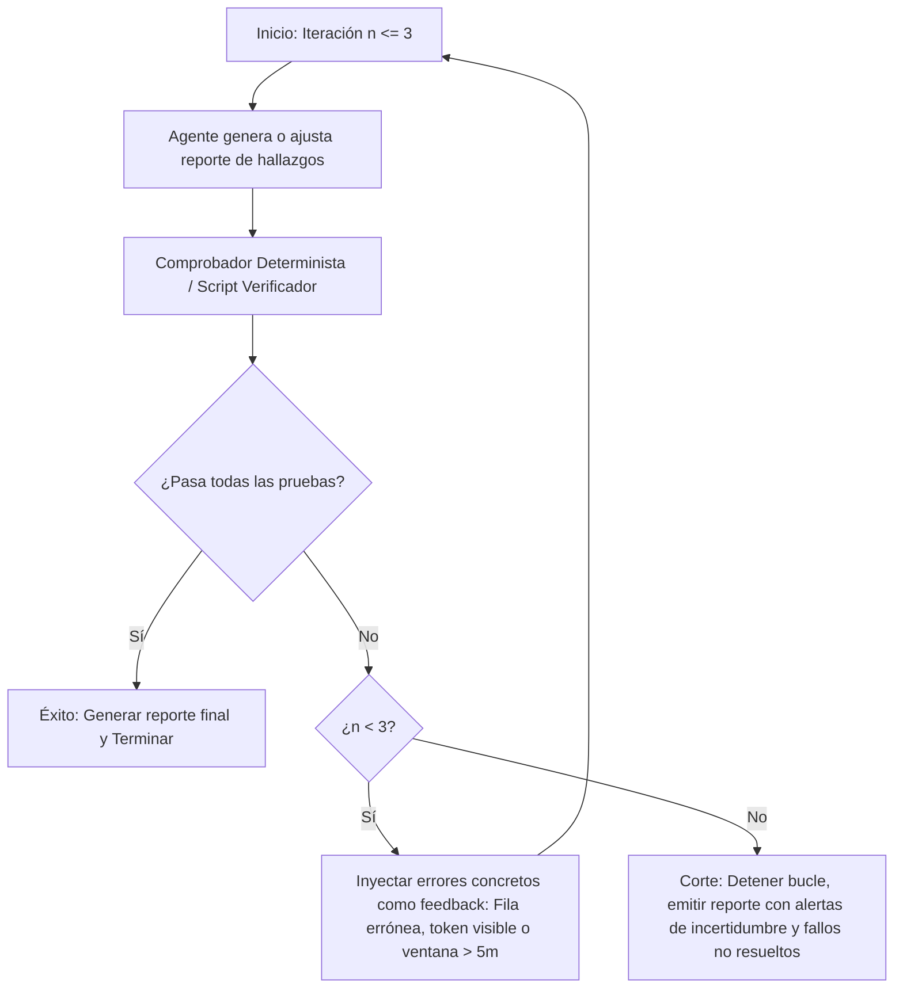

# Respuestas Teóricas y Arquitectura — Misión 6

---

## 1. Skill frente a Plugin

### ¿Por qué `incident-investigator` es un Skill?
`incident-investigator` es un **Skill** porque es una unidad autónoma de conocimiento procedimental y contextual. No añade binarios ni herramientas nativas al entorno; en su lugar, le enseña al agente **cómo, cuándo y bajo qué criterios** debe investigar logs de seguridad, organizando instrucciones paso a paso (`SKILL.md`), reglas de dominio (`references/detection-rules.md`) y scripts auxiliares opcionales. Su activación es progresiva y ocurre bajo demanda según la solicitud del usuario.

### ¿Qué componentes adicionales permitirían empaquetarlo como Plugin?
Un **Plugin** es un paquete distribuible y versionable que agrupa múltiples extensiones del agente bajo un mismo manifiesto (`plugin.json`). Para convertir y distribuir `incident-investigator` como un plugin completo de seguridad para Antigravity / Gemini CLI / Claude Code, se podrían empaquetar los siguientes componentes:

1. **Manifiesto del Plugin (`plugin.json`):** Metadatos que declaran nombre, versión, autor, dependencias y las capacidades que expone.
2. **Slash Command personalizado (e.g. `/investigate` o `/triage`):** Un comando directo en la interfaz de chat para que el usuario dispare la investigación de un CSV sin tener que redactar un prompt largo.
3. **Lifecycle Hooks (`hooks.json`):**
   * *Pre-Tool Execution Hook:* Un hook que intercepte cualquier lectura de archivos con extensión `.csv` o `.log` para verificar de antemano si contiene secretos en texto plano (`token=`) y alertar o anonimizarlos antes de que lleguen a la ventana de contexto.
   * *Post-Response Hook:* Para validar automáticamente que ninguna salida generada contenga tokens sin redactar antes de mostrarla al usuario.
4. **Servidor MCP (Model Context Protocol):** Un conector estandarizado que provea herramientas nativas para conectarse directamente a sistemas SIEM o almacenes de logs (e.g. Google Cloud Logging, Splunk, ElasticSearch, BigQuery) en lugar de depender únicamente de archivos CSV locales.

---

## 2. Implementación de un Bucle de Retroalimentación (Ralph Loop)

El patrón **Ralph Loop** permite que el agente ejecute un ciclo autónomo de auto-corrección guiado por pruebas deterministas y verificables, evitando alucinaciones o fabricaciones.

### Diseño del Bucle para Investigación de Logs:
* **Entrada:** Archivo `logs_sinteticos.csv` y reglas en `detection-rules.md`.
* **Límite de Iteraciones:** Máximo **3 iteraciones**.
* **Condición de Salida Inmediata (Early Exit):** El ciclo termina de inmediato en cuanto se satisfacen todas las comprobaciones verificables, o al alcanzar la 3ª iteración.

### Pasos por Iteración:

### Comprobaciones Verificables (Tests Automatizados):
1. **Verificación de Existencia de Filas:** Para cada fila citada (ej. Fila $k$), verificar que $1 \le k \le 94$ y que los valores de `timestamp`, `ip`, `user` en el reporte coincidan textualmente con la línea $k$ del CSV original.
2. **Verificación de Redacción de Secretos:** Comprobar mediante expresión regular que ninguna ocurrencia de `token=` en la salida contenga valores alfanuméricos sin el reemplazo estricto `[REDACTED]`.
3. **Verificación de Ventana Temporal:** Para las alertas de fuerza bruta y password spraying, calcular programáticamente la diferencia $(t_{\text{fin}} - t_{\text{inicio}}) \le 300\text{ s}$ para comprobar que la ventana no sobrepasa los 5 minutos.
4. **Criterio Anti-Invención:** Prohibir explícitamente agregar IPs o usuarios que no existan en el CSV base; si el validador detecta una IP inexistente, el loop rechaza la iteración y le exige al agente rectificar utilizando únicamente datos del archivo original.

